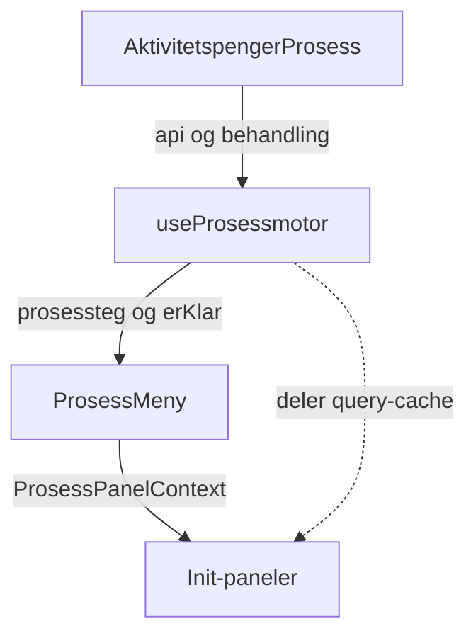

# Prosessmotor for aktivitetspenger

`useProsessmotor` bestemmer hvilke steg prosessmenyen viser for en aktivitetspengerbehandling, og hvilken farge hvert steg får. Init-panelene bruker fargen til å avgjøre om de viser innholdet sitt, «Dette steget er ikke behandlet» eller en hentefeil.

Reglene følger den gamle prosessriggen i `behandling-felles` (`ProsessStegUtledet`, `prosessStegHooks`). Der aktivitetspenger gjør noe annet, står det i [Avvik fra gammel rigg](#avvik-fra-gammel-rigg).

## Slik henger det sammen

1. [AktivitetspengerProsess.tsx](src/components/AktivitetspengerProsess.tsx) kaller `useProsessmotor` og sender `prosessteg` og `erKlar` til `ProsessMeny`. Den rendrer ett init-panel per steg.
2. [Prosessmotor.ts](src/components/Prosessmotor.ts) henter data og regner ut status og farge for hvert steg.
3. [ProsessMeny.tsx](../v2/gui/src/behandling/prosess/ProsessMeny.tsx) viser menyen, velger panel og legger `ProsessPanelContext` rundt init-panelene.
4. Init-panelene i [src/components/prosess](src/components/prosess) leser konteksten og bestemmer hva de viser.

`ProsessPanelContext` har to funksjoner:

| Funksjon                            | Sann når                                                         |
| ----------------------------------- | ---------------------------------------------------------------- |
| `erValgt(id)`                       | Steget er valgt i menyen. Ellers rendrer init-panelet ingenting. |
| `erTilBehandlingEllerBehandlet(id)` | Steget har en annen farge enn grå.                               |

### Steg

Prosessmotoren returnerer alltid seks steg i denne rekkefølgen:

| Steg                        | Panel-ID (`prosessStegCodes`) | Init-panel                                    |
| --------------------------- | ----------------------------- | --------------------------------------------- |
| Inngangsvilkår eller Opphør | `INNGANGSVILKAR` / `OPPHØR`   | `InngangsvilkårInitPanel` / `OpphørInitPanel` |
| Medlemskap                  | `FORUTGAENDE_MEDLEMSKAP`      | `ForutgåendeMedlemskapInitPanel`              |
| Beregning                   | `BEREGNING`                   | `BeregningProsessStegInitPanel`               |
| Beregnet utbetaling         | `KONTROLL_AV_INNTEKT`         | `BeregnetUtbetalingStegInitPanel`             |
| Simulering                  | `SIMULERING`                  | `SimuleringProsessStegInitPanel`              |
| Vedtak                      | `VEDTAK`                      | `VedtakProsessStegInitPanel`                  |

Opphør erstatter inngangsvilkår når behandlingen er en revurdering med årsak `ENDRET_BOSTED` eller `ENDRET_LIVSOPPHOLDSYTELSE` (`erAktivitetspengerOpphørsbehandling`).

Hvilke vilkår og aksjonspunkter som hører til hvert steg, står i `PANEL_KONFIG` i [Prosessmotor.ts](src/components/Prosessmotor.ts).

## Data og cache

Prosessmotoren henter disse dataene med `useQuery`:

| Data                | Query-funksjon                         | Brukes til                         |
| ------------------- | -------------------------------------- | ---------------------------------- |
| Vilkår              | `vilkårQueryOptions`                   | Inngangsvilkår, medlemskap, vedtak |
| Aksjonspunkter      | `aksjonspunkterQueryOptions`           | Alle steg                          |
| Innlogget bruker    | `innloggetBrukerQueryOptions`          | Låsing av første steg              |
| Beregningsgrunnlag  | `beregningsgrunnlagQueryOptions`       | Beregning                          |
| Sats og utbetaling  | `satsOgUtbetalingPerioderQueryOptions` | Beregnet utbetaling                |
| Kontroll av inntekt | `kontrollerInntektQueryOptions`        | Beregnet utbetaling                |
| Simuleringsresultat | `simuleringResultatQueryOptions`       | Simulering                         |

Query-funksjonene ligger i [aktivitetspengerQueryOptions.ts](../v2/gui/src/prosess/aktivitetspenger-prosess/aktivitetspengerQueryOptions.ts).

- Init-panelene bruker de samme query-funksjonene. De deler cache med prosessmotoren, så statusberegningen gir ingen ekstra kall.
- For beregningsgrunnlag, sats og simulering er `enabled` en del av query-nøkkelen. Prosessmotoren henter alltid med `enabled = true`. Init-panelene sender `erTilBehandlingEllerBehandlet`, så de treffer samme cache-oppføring når steget har farge.
- Beregningsgrunnlag, sats, kontroll av inntekt og simulering har `throwOnError: false`. En hentefeil gir grått steg, ikke feilside.
- `placeholderData` beholder forrige svar bare for samme behandling. Da blinker ikke fargene når behandlingsversjonen endres, og status fra en annen behandling vises aldri.
- `erKlar` er sann når ingen av queryene henter, og vilkår, aksjonspunkter og innlogget bruker finnes. `ProsessMeny` velger ikke panel ut fra URL-en før `erKlar` er sann.

### Tomme svar og feil

- `getBeregningsgrunnlag` og `getSimuleringResultat` i [AktivitetspengerBackendClient.ts](../v2/gui/src/prosess/aktivitetspenger-prosess/AktivitetspengerBackendClient.ts) returnerer `null` ved 204. Uten dette gir den genererte klienten `{}` eller en `ReadableStream` som data.
- `harData` i prosessmotoren regner `null`, `undefined`, tom liste og objekt uten felter som manglende data.
- Alle andre svar enn 2xx regnes som feil, også 404.

## Fra status til farge

Hvert steg får først en status (`Utfall`). `finnProsessmenyType` gjør den om til farge:

| Betingelse                                                         | Farge | `ProcessMenuStepType` |
| ------------------------------------------------------------------ | ----- | --------------------- |
| Et relevant aksjonspunkt er `OPPRETTET` og har `kanLoses === true` | Gul   | `warning`             |
| Status er `OPPFYLT`                                                | Grønn | `success`             |
| Status er `IKKE_OPPFYLT`                                           | Rød   | `danger`              |
| Alt annet                                                          | Grå   | `default`             |

Gul vinner over alt annet, også når steget er stoppet etter et avslag.

Et aksjonspunkt regnes som åpent på to måter:

- For gul må aksjonspunktet både være `OPPRETTET` og ha `kanLoses`. Saksbehandler kan altså gjøre noe i steget nå.
- For status holder det at aksjonspunktet er `OPPRETTET`. Et aksjonspunkt som venter eller ikke kan løses ennå, betyr fortsatt at steget ikke er ferdig.

### Felles statusregel

`finnStatus(vilkår, aksjonspunkter)` brukes av alle steg som har vilkår eller aksjonspunkter:

1. Har steget vilkår, avgjør periodene statusen:
   - Ingen perioder å telle, eller minst én `IKKE_VURDERT`, gir `IKKE_VURDERT`.
   - Minst én `OPPFYLT` gir `OPPFYLT`.
   - Ellers `IKKE_OPPFYLT`.
2. Har steget bare aksjonspunkter, gir et åpent aksjonspunkt `IKKE_VURDERT`. Ellers `OPPFYLT`.
3. Har steget verken vilkår eller aksjonspunkter, blir det `IKKE_VURDERT`.

### Hvilke perioder som teller

`finnPerioderSomTeller` velger periodene for både status og delvis vurdert:

- Perioder med `IKKE_RELEVANT` telles ikke.
- Har noen av de øvrige periodene `vurderesIBehandlingen`, teller bare de.
- Har ingen av dem `vurderesIBehandlingen`, teller alle. Da får steget utfallet fra tidligere behandling, for eksempel i en revurdering der vilkåret ikke vurderes på nytt.

Et vilkår der alle periodene er `IKKE_RELEVANT` (`erIkkeRelevant`), holdes helt utenfor steget. Panelet viser det som «Ingen perioder å vurdere».

### Delvis vurdert

`usePartialStatus` gir en egen markering i menyen. Den vises bare når steget er grønt.

- For vilkårssteg (`erDelvisVurdert`) er steget delvis vurdert når periodene som teller har mer enn ett ulikt utfall, og minst ett av dem er `OPPFYLT` eller `IKKE_OPPFYLT`.
- For vedtak er steget delvis vurdert når minst én periode er `OPPFYLT` og minst én er `IKKE_OPPFYLT`, blant alle perioder i alle vilkår.

## Status per steg

### Inngangsvilkår

Hvert inngangsvilkår i `PANEL_KONFIG.inngangsvilkår.vilkår` som finnes i dataene og ikke er ikke-relevant, blir et delpanel med status fra `finnStatus`. `finnSamletStatus` slår delpanelene sammen:

- Ett delpanel `IKKE_OPPFYLT` gir `IKKE_OPPFYLT`.
- Alle delpaneler `OPPFYLT` gir `OPPFYLT`.
- Ellers `IKKE_VURDERT`.

Reserven med tidligere perioder gjelder per vilkår. Vurderes bare bostedsvilkåret på nytt, teller de andre vilkårene med sitt tidligere utfall.

Finnes ingen delpaneler, kommer statusen fra aksjonspunktene for inngangsvilkår.

Steget er delvis vurdert hvis minst ett delpanel er det. Steget er låst (`locked`) når det er grønt og brukeren verken kan saksbehandle eller beslutte del 1 (`aktivitetspengerDel1SaksbehandlerTilgang`).

### Opphør

Opphør har ingen vilkår i `PANEL_KONFIG`. Statusen kommer bare fra aksjonspunktene for opphør, med den felles statusregelen. Uten relevante aksjonspunkter er steget grått. Låsing følger samme regel som for inngangsvilkår.

Opphørspanelet viser vurderingene av bostedsvilkåret og vilkåret om andre livsoppholdsytelser også når steget er grått. Det skjer for eksempel i en opphørsbehandling uten relevante aksjonspunkter.

### Medlemskap

Status fra `finnStatus` med forutgående medlemskap som vilkår og `AVKLAR_GYLDIG_MEDLEMSKAP` som aksjonspunkt. Reserven med tidligere perioder gjelder også her.

### Beregning

Grønn når beregningsgrunnlaget har data, ellers grå. Steget har ingen aksjonspunkter.

### Beregnet utbetaling

Grønn når sats og utbetaling eller kontrollperiodene for inntekt har data, ellers grå. `KONTROLLER_INNTEKT` gir gul. Arbeidsgiveropplysningene påvirker ikke statusen, fordi de finnes før steget er kjørt.

### Simulering

Grønn når simuleringsresultatet har data, ellers grå. `VURDER_FEILUTBETALING` gir gul.

### Vedtak

`finnStatusForVedtak` ser på alle vilkår og alle perioder, uten å filtrere på `vurderesIBehandlingen`:

1. Ingen vilkår gir `IKKE_VURDERT`.
2. En periode med `IKKE_VURDERT` gir `IKKE_VURDERT`.
3. Et åpent aksjonspunkt som ikke hører til vedtak, gir `IKKE_VURDERT`.
4. Mangler behandlingsresultatet type, blir det `IKKE_VURDERT`.
5. Avslag (`AVSLÅTT`) eller opphør (`OPPHØR`) gir `IKKE_OPPFYLT`. Ellers `OPPFYLT`.

Aksjonspunktene for vedtak (blant annet `FORESLÅ_VEDTAK` og `FATTER_VEDTAK`) gir gul når de kan løses.

## Stopp etter avslag

Prosessmotoren går gjennom stegene i rekkefølge. Er forrige steg rødt eller grått, blir dette steget og alle senere steg grå. Stoppet kan bare ramme medlemskap, beregning og beregnet utbetaling. Simulering og vedtak får alltid sin egen status.

To unntak gjør at et rødt eller grått steg ikke stopper resten:

- **Søknadsfrist:** Har inngangsvilkår et delpanel for søknadsfrist, og alle de andre delpanelene er `OPPFYLT`, stoppes ikke senere steg. Det gjelder selv om søknadsfristen ikke er oppfylt.
- **Ingenting å vurdere:** Inngangsvilkår eller opphør uten delpaneler og uten relevante aksjonspunkter stopper ikke. Det samme gjelder medlemskap uten relevante vilkår og uten aksjonspunkter (`stopperSenereSteg: false`).

Beregning og beregnet utbetaling har ingen slike unntak. Mangler beregningsgrunnlaget, blir derfor beregnet utbetaling også grå.

## Visning i init-panelene

| Init-panel          | Grått steg                       | Hentefeil i prosessmotoren                                       |
| ------------------- | -------------------------------- | ---------------------------------------------------------------- |
| Inngangsvilkår      | «Dette steget er ikke behandlet» | Feilside                                                         |
| Opphør              | Vurderingene vises likevel       | Feilside                                                         |
| Medlemskap          | «Dette steget er ikke behandlet» | Feilside                                                         |
| Beregning           | «Dette steget er ikke behandlet» | Feilmelding i panelet                                            |
| Beregnet utbetaling | «Dette steget er ikke behandlet» | Feilmelding i panelet hvis sats eller kontroll av inntekt feilet |
| Simulering          | «Dette steget er ikke behandlet» | Feilmelding i panelet                                            |
| Vedtak              | «Dette steget er ikke behandlet» | Feilside                                                         |

Inngangsvilkår, opphør, medlemskap og vedtak får status fra vilkår og aksjonspunkter. De queryene har ikke `throwOnError: false`, så en feil går til `ErrorBoundary` rundt hele behandlingen og gir feilside.

Feilmeldingen i panelet er `ProsessStegHentingFeilet` i [ProsessStegHentingFeilet.tsx](../v2/gui/src/behandling/prosess/ProsessStegHentingFeilet.tsx). Init-panelene leser feilen fra samme query som prosessmotoren, med `enabled: false`, så de henter ikke på nytt. Saksbehandler må laste siden på nytt for å prøve igjen.

Når steget har farge, bruker init-panelet sine egne suspense-queries. Feiler et av dem, går feilen også til `ErrorBoundary`. Kontroll av inntekt i beregnet utbetaling er et unntak og viser en egen feilmelding.

Når steget har farge, viser inngangsvilkår og medlemskap også perioder fra tidligere behandlinger. De er låst for redigering. Medlemskapspanelet (`ForutgåendeMedlemskap`) viser i tillegg selv «ikke behandlet» når det verken finnes aksjonspunkt, perioder som vurderes eller perioder med kjent utfall.

### Hvilket steg som velges

`ProsessMeny` velger steg slik:

- Ved `punkt=default` velges siste steg (vedtak) hvis alle stegene er grønne eller røde. Ellers velges første gule steg, og finnes ingen gule steg, det første steget.
- Har `punkt` en gyldig panel-ID, velges det steget.
- Ellers velges første gule steg, hvis det finnes.

Et grått steg gjør at menyen ikke regner behandlingen som ferdig, selv om resten er grønt.

## Avvik fra gammel rigg

- Gammel rigg teller bare perioder med `vurderesIBehandlingen`. Aktivitetspenger bruker tidligere perioder når ingen vurderes i behandlingen.
- Gammel rigg teller `IKKE_RELEVANT` som avslag. Aktivitetspenger holder slike perioder og vilkår utenfor.
- Gammel rigg stopper alltid senere steg etter et rødt eller grått steg. Aktivitetspenger stopper ikke når steget ikke har noe å vurdere.
- Gammel rigg viser lasteside når data ikke kan hentes. Aktivitetspenger gir grått steg og feilmelding i panelet.
- Gammel rigg skjuler steg uten relevante vilkår eller aksjonspunkter. Aktivitetspenger viser alltid alle seks.
- Låsing av inngangsvilkår og opphør finnes bare i aktivitetspenger.

## Tester

- [Prosessmotor.spec.tsx](src/components/Prosessmotor.spec.tsx) dekker statusreglene, stopp etter avslag og `erKlar`.
- Spec-filene i [src/components/prosess](src/components/prosess) dekker visning ved grått steg og ved hentefeil.
- [AktivitetspengerBackendClient.spec.ts](../v2/gui/src/prosess/aktivitetspenger-prosess/AktivitetspengerBackendClient.spec.ts) dekker 204-håndteringen.
