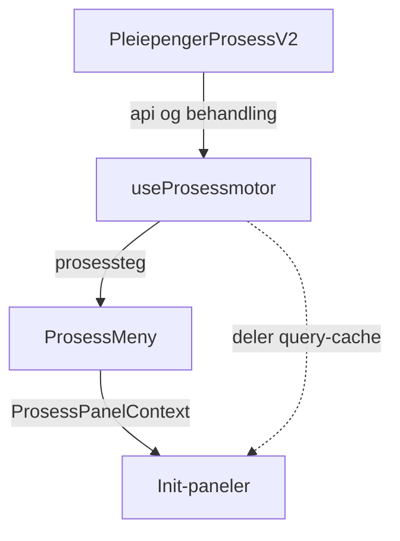

# Prosessmotor for pleiepenger

`useProsessmotor` bestemmer hvilke steg prosessmenyen viser for en pleiepengebehandling, og hvilken farge hvert steg får. Init-panelene bruker fargen til å avgjøre om de viser innholdet sitt eller «Dette steget er ikke behandlet».

Reglene følger den gamle prosessriggen i `behandling-felles` (`ProsessStegUtledet`, `prosessStegHooks`) og paneldefinisjonene i [src/panelDefinisjoner/prosessStegPaneler](src/panelDefinisjoner/prosessStegPaneler). Der den nye motoren gjør noe annet, står det i [Avvik fra gammel rigg](#avvik-fra-gammel-rigg).

Den nye menyen brukes når feature togglen `PROSESS_MENY_V2` er på. Da velger [useProsessMenyToggle.tsx](../v2/gui/src/behandling/prosess/hooks/useProsessMenyToggle.tsx) mellom ny og gammel meny. Når `SKJUL_PROSESS_MENY_V2_VELGER` også er på, brukes alltid den nye menyen, og velgeren vises ikke. I Q er begge togglene på. I prod er `PROSESS_MENY_V2` av.

## Slik henger det sammen

1. [PleiepengerProsessV2.tsx](src/components/PleiepengerProsessV2.tsx) kaller `useProsessmotor` og sender stegene til `ProsessMeny`. Den rendrer ett init-panel per steg.
2. [Prosessmotor.ts](src/prosess/api/Prosessmotor.ts) henter data og regner ut status og farge for hvert steg.
3. [ProsessMeny.tsx](../v2/gui/src/behandling/prosess/ProsessMeny.tsx) viser menyen, velger steg og legger `ProsessPanelContext` rundt init-panelene.
4. Init-panelene i [src/prosess](src/prosess) leser konteksten og bestemmer hva de viser.

`ProsessPanelContext` har to funksjoner:

| Funksjon                            | Sann når                                                         |
| ----------------------------------- | ---------------------------------------------------------------- |
| `erValgt(id)`                       | Steget er valgt i menyen. Ellers rendrer init-panelet ingenting. |
| `erTilBehandlingEllerBehandlet(id)` | Steget har en annen farge enn grå.                               |

Er steget grått, viser init-panelet «Dette steget er ikke behandlet» (`ProsessStegIkkeBehandlet`).

## Steg

Stegene kommer i denne rekkefølgen:

| Steg                        | Panel-ID (`prosessStegCodes`) | Init-panel                                | Vises                                      |
| --------------------------- | ----------------------------- | ----------------------------------------- | ------------------------------------------ |
| Inngangsvilkår              | `INNGANGSVILKAR`              | `InngangsvilkarProsessStegInitPanel`      | Når behandlingen har ett av stegets vilkår |
| Sykdom                      | `MEDISINSK_VILKAR`            | `MedisinskVilkarProsessStegInitPanel`     | Når behandlingen har ett av stegets vilkår |
| Inngangsvilkår Fortsettelse | `OPPTJENING`                  | `InngangsvilkarFortsProsessStegInitPanel` | Når behandlingen har ett av stegets vilkår |
| Beregning                   | `BEREGNINGSGRUNNLAG`          | `BeregningsgrunnlagProsessStegInitPanel`  | Alltid                                     |
| Uttak                       | `UTTAK`                       | `UttakProsessStegInitPanel`               | Alltid                                     |
| Tilkjent ytelse             | `TILKJENT_YTELSE`             | `TilkjentYtelseProsessStegInitPanel`      | Alltid                                     |
| Simulering                  | `SIMULERING`                  | `SimuleringProsessStegInitPanel`          | Alltid                                     |
| Vedtak                      | `VEDTAK`                      | `VedtakProsessStegInitPanel`              | Alltid                                     |

Det finnes ikke noe eget steg for fortsatt medlemskap. I gammel rigg vises det steget bare når behandlingen har aksjonspunkt 6012, og den koden finnes ikke i backend. Overstyring av medlemskapsvilkåret ligger i delpanelet for medlemskap i Inngangsvilkår Fortsettelse. Se også [overstyring-skillen](../../.github/skills/overstyring/SKILL.md).

### Delpaneler

Vilkårsstegene består av delpaneler, slik som i gammel rigg. Et delpanel tas bare med når behandlingen har vilkåret.

| Steg                        | Delpanel     | Vilkår                                                   | Aksjonspunkter                                                                    |
| --------------------------- | ------------ | -------------------------------------------------------- | --------------------------------------------------------------------------------- |
| Inngangsvilkår              | Søknadsfrist | `SØKNADSFRIST`                                           | `OVERSTYRING_AV_SØKNADSFRISTVILKÅRET`, `KONTROLLER_OPPLYSNINGER_OM_SØKNADSFRIST`  |
| Inngangsvilkår              | Alder        | `ALDERSVILKÅR`                                           | Ingen                                                                             |
| Inngangsvilkår              | Omsorgen for | `OMSORGEN_FOR`                                           | `OVERSTYRING_AV_OMSORGEN_FOR`                                                     |
| Sykdom                      | Sykdom       | `MEDISINSKEVILKÅR_UNDER_18_ÅR`, `MEDISINSKEVILKÅR_18_ÅR` | `KONTROLLER_LEGEERKLÆRING`                                                        |
| Inngangsvilkår Fortsettelse | Opptjening   | `OPPTJENINGSVILKÅRET`                                    | `VURDER_OPPTJENINGSVILKÅRET`, eller `OVERSTYRING_AV_OPPTJENINGSVILKÅRET` uten den |
| Inngangsvilkår Fortsettelse | Medlemskap   | `MEDLEMSKAPSVILKÅRET`                                    | `OVERSTYRING_AV_MEDLEMSKAPSVILKÅRET`                                              |

Aksjonspunktene for de andre stegene står i `PANEL_KONFIG` i [Prosessmotor.ts](src/prosess/api/Prosessmotor.ts).

## Data og cache

Prosessmotoren henter disse dataene med `useSuspenseQuery`:

| Data                | Query-funksjon                              | Brukes til               |
| ------------------- | ------------------------------------------- | ------------------------ |
| Vilkår              | `vilkårQueryOptions`                        | Vilkårsstegene og vedtak |
| Aksjonspunkter      | `aksjonspunkterQueryOptions`                | Alle steg                |
| Uttak               | `uttakQueryOptions` (via `UttakApiContext`) | Uttak                    |
| Beregningsresultat  | `beregningsresultatUtbetalingQueryOptions`  | Tilkjent ytelse          |
| Simuleringsresultat | `simuleringResultatQueryOptions`            | Simulering               |

- Query-funksjonene ligger i [k9SakQueryOptions.ts](src/prosess/api/k9SakQueryOptions.ts) og [uttakQueryOptions.ts](../v2/gui/src/prosess/uttak/api/uttakQueryOptions.ts). Init-panelene bruker de samme funksjonene og deler derfor cache med prosessmotoren.
- Query-nøklene inneholder `behandling.versjon`, så alt hentes på nytt når behandlingen endres.
- Hooken suspenderer til alle dataene er hentet. En hentefeil kastes videre til nærmeste `ErrorBoundary`.
- `PleiepengerProsessV2` sender `erKlar` til `ProsessMeny`. Den er sann når aksjonspunktene ikke hentes. Før det velger ikke menyen steg ut fra URL-en.

## Fra status til farge

Hvert steg får først en status (`OPPFYLT`, `IKKE_OPPFYLT` eller `IKKE_VURDERT`). `finnProsessmenyType` gjør den om til farge:

| Betingelse                                                         | Farge | `ProcessMenuStepType` |
| ------------------------------------------------------------------ | ----- | --------------------- |
| Et relevant aksjonspunkt er `OPPRETTET` og har `kanLoses === true` | Gul   | `warning`             |
| Status er `OPPFYLT`                                                | Grønn | `success`             |
| Status er `IKKE_OPPFYLT`                                           | Rød   | `danger`              |
| Alt annet                                                          | Grå   | `default`             |

Gul vinner over alt annet, også når steget er stoppet av et tidligere steg.

Et aksjonspunkt regnes som åpent på to måter:

- For gul må aksjonspunktet både være `OPPRETTET` og ha `kanLoses`. Saksbehandleren kan altså gjøre noe i steget nå.
- For status holder det at aksjonspunktet er `OPPRETTET`. Et aksjonspunkt som ikke kan løses ennå, betyr fortsatt at steget ikke er ferdig.

### Status for et delpanel

`finnDelpanelStatus` brukes for delpanelene og for beregning:

1. Har delpanelet vilkår, teller bare perioder med `vurderesIBehandlingen`:
   - Ingen slike perioder, eller minst én `IKKE_VURDERT`, gir `IKKE_VURDERT`.
   - Minst én `OPPFYLT` gir `OPPFYLT`.
   - Ellers `IKKE_OPPFYLT`, også når periodene er `IKKE_RELEVANT`.
2. Har delpanelet bare aksjonspunkter, gir et åpent aksjonspunkt `IKKE_VURDERT`. Ellers `OPPFYLT`.
3. Har delpanelet verken vilkår eller aksjonspunkter, blir det `IKKE_VURDERT`.

Perioder fra tidligere behandlinger teller ikke. Vurderes ingen perioder i behandlingen, er delpanelet ikke vurdert.

### Status for et steg

`finnSamletStatus` slår delpanelene sammen:

- Ett delpanel `IKKE_OPPFYLT` gir `IKKE_OPPFYLT`.
- Minst ett delpanel `OPPFYLT` og ingen `IKKE_VURDERT` gir `OPPFYLT`.
- Ellers `IKKE_VURDERT`.

Rødt vinner altså over grått.

### Delvis vurdert

`usePartialStatus` gir en egen markering i menyen. Den vises bare når steget er grønt.

- For vilkårsstegene er steget delvis vurdert når minst ett delpanel er det (`sjekkDelvisVilkårStatus`). Et delpanel er delvis vurdert når periodene som vurderes i behandlingen har mer enn ett utfall, og minst ett av dem er `OPPFYLT` eller `IKKE_OPPFYLT`.
- For vedtak er steget delvis vurdert når minst én periode er `OPPFYLT` og minst én er `IKKE_OPPFYLT`, blant alle perioder i alle vilkår.

## Status per steg

### Inngangsvilkår, sykdom og Inngangsvilkår Fortsettelse

Statusen kommer fra delpanelene, som beskrevet over. For opptjening brukes `OVERSTYRING_AV_OPPTJENINGSVILKÅRET` når behandlingen ikke har `VURDER_OPPTJENINGSVILKÅRET`, slik som overstyringspanelet i gammel rigg.

### Beregning

Felles statusregel med beregningsgrunnlagsvilkåret og aksjonspunktene for beregning. Uten vilkår og aksjonspunkter er steget grått.

### Uttak

Statusen kommer bare fra uttaksplanen:

- Ingen perioder gir `IKKE_VURDERT`.
- Alle perioder `IKKE_OPPFYLT` gir `IKKE_OPPFYLT`.
- Ellers `OPPFYLT`.

Aksjonspunktene for uttak gir gul, men påvirker ikke statusen. Et åpent aksjonspunkt i uttak stopper derfor ikke tilkjent ytelse.

### Tilkjent ytelse

- Mangler beregningsresultatet eller periodelisten, blir det `IKKE_VURDERT`.
- Har ingen andel et uttak med utfall `INNVILGET`, blir det `IKKE_OPPFYLT`. Det gjelder også en tom periodeliste.
- Ellers `OPPFYLT`.

`VURDER_TILBAKETREKK` gir gul.

### Simulering

`OPPFYLT` når simuleringsresultatet finnes, ellers `IKKE_VURDERT`. `VURDER_FEILUTBETALING` og `SJEKK_HØY_ETTERBETALING` gir gul.

### Vedtak

`finnVedtakStatus` følger `findStatusForVedtak` i [vedtakStatusUtlederPleiepenger.ts](src/panelDefinisjoner/vedtakStatusUtlederPleiepenger.ts). Den ser på alle vilkår og alle perioder, uten å filtrere på `vurderesIBehandlingen`:

1. Ingen vilkår gir `IKKE_VURDERT`.
2. En periode med `IKKE_VURDERT` gir `IKKE_VURDERT`.
3. Et åpent aksjonspunkt som ikke hører til vedtak, gir `IKKE_VURDERT`. Det gjelder også `OVERSTYRING_AV_BEREGNING`.
4. Mangler behandlingsresultatet type, blir det `IKKE_VURDERT`.
5. Avslag gir `IKKE_OPPFYLT`. Ellers `OPPFYLT`.

Et vedtaksaksjonspunkt som er åpent og kan løses, gir gul. Det gjelder også når behandlingen er til beslutter (`FATTER_VEDTAK`), og når vilkår eller andre aksjonspunkter ikke er ferdige.

## Stopp etter avslag

Prosessmotoren går gjennom stegene i rekkefølge. Er forrige steg rødt eller grått, blir dette steget og alle senere steg grå. Stoppet varer resten av prosessen.

- Uttak og simulering stoppes aldri, og vedtak får alltid sin egen status.
- «Forrige steg» er forrige steg som vises. Skjulte steg hoppes over.
- Uttak ligger mellom beregning og tilkjent ytelse. Et grått beregningssteg stopper derfor ikke tilkjent ytelse. Er beregning selv stoppet av et tidligere steg, er tilkjent ytelse også stoppet.
- Et stoppet steg blir likevel gult når det har et åpent aksjonspunkt som kan løses.

**Unntak for søknadsfrist:** Har forrige steg et delpanel for søknadsfrist, og alle de andre delpanelene er `OPPFYLT`, stoppes ikke senere steg. Det gjelder selv om søknadsfristen ikke er oppfylt eller ikke vurdert.

## Hvilket steg som velges

`ProsessMeny` velger steg slik:

- Ved `punkt=default` velges siste steg (vedtak) hvis alle stegene er grønne eller røde. Ellers velges første gule steg, og finnes ingen gule steg, det første steget.
- Har `punkt` en gyldig panel-ID, velges det steget.
- Ellers velges første gule steg, hvis det finnes.

## Avvik fra gammel rigg

- Delvis vurdert vises bare på grønne steg. Gammel rigg setter markeringen uansett farge.
- Når saksbehandleren klikker «Overstyr», blir steget gult i gammel rigg. Den nye motoren vet ikke om overstyringsvalget.
- Stegvalget følger `ProsessMeny`, som er felles for alle v2-menyer. Gammel rigg velger ingen steg når `punkt` mangler, og ved `punkt=default` velger den siste steg når behandlingen er henlagt.
- Mangler behandlingsresultatet eller periodelisten i beregningsresultatet, krasjer gammel rigg. Den nye motoren viser steget som grått.

## Tester

[Prosessmotor.spec.tsx](src/prosess/api/Prosessmotor.spec.tsx) dekker hvilke steg som vises, statusreglene, farger, delvis vurdert, stopp etter avslag med unntaket for søknadsfrist, og vedtak.
